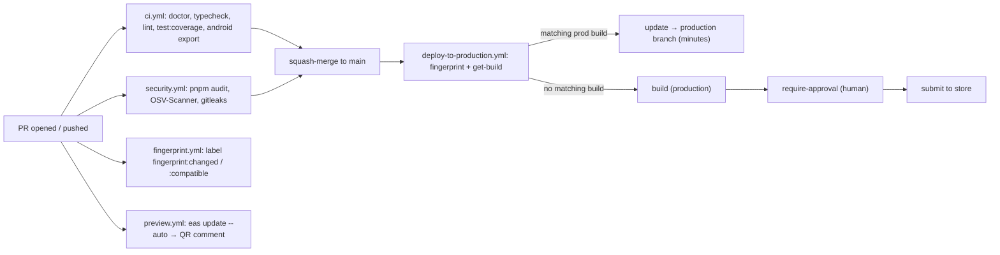

# 10 — CI/CD & release rules

**Scope:** Everything between a finished change and users' devices — GitHub Actions, EAS Update previews, the fingerprint-gated production deploy, EAS builds, versioning, commits, and PRs. What counts as a native change: [08 §5](08-native-config.md#5-native-change-detection--build-not-ota). Ticket → branch → PR handoff: [ticket-workflow](../../.github/instructions/ticket-workflow.instructions.md).

## Non-negotiables

- [ ] `pnpm check` passes before a task is done (hook: Stop; CI re-runs it with coverage).
- [ ] `pnpm deps:check` clean before every PR; `pnpm doctor:expo` after any dependency change. CI runs `pnpm doctor:ci`: a new upstream Expo patch release only warns on regular PRs; Renovate PRs run the strict `doctor:expo` (#21).
- [ ] Local agents never change git state — hand over commit/PR text (hook: guard-git). Whoever commits never uses `--no-verify`.
- [ ] A PR labelled `fingerprint:changed` (CI: fingerprint.yml) MUST say **"requires store release"** in its description, with the reason.
- [ ] NEVER publish (or let merge publish) an OTA update that depends on new native code.
- [ ] NEVER trigger EAS **cloud** builds — Free plan limits. Local builds are free and unlimited.
- [ ] Conventional Commits; small PRs, one concern each; agent-opened PRs are drafts.
- [ ] NEVER commit `ios/`, `android/`, `.env`, credentials, or `google-service-account.json` (CI: gitleaks).
- [ ] Edits to `.github/`, `.eas/`, `.claude/`, lint/TS/Jest config, `eas.json`, `app.config.ts` need the maintainer (hook asks; CODEOWNERS + ruleset require review).

## 1. The pipeline



**GitHub Actions** ([.github/workflows/](../../.github/workflows/), free Linux runners, all actions SHA-pinned, least-privilege `permissions`):

- [ci.yml](../../.github/workflows/ci.yml) — `pnpm install --frozen-lockfile`, `pnpm doctor:expo`, `pnpm typecheck`, `pnpm lint`, `pnpm test:coverage --ci`, `pnpm docs:check`, `expo export --platform android` (bundle smoke check — web is not a target; runs with no `EXPO_PUBLIC_*` env on purpose, like EAS Update bundles).
- [security.yml](../../.github/workflows/security.yml) — `pnpm audit --prod --audit-level=high`, OSV-Scanner on `pnpm-lock.yaml`, gitleaks. Also weekly on a schedule.
- [fingerprint.yml](../../.github/workflows/fingerprint.yml) — labels the PR `fingerprint:changed` (merge ⇒ store build) or `fingerprint:compatible` (merge ⇒ OTA). This label is the authoritative "requires store release" signal; don't guess.
- [preview.yml](../../.github/workflows/preview.yml) — EAS Update preview (`APP_VARIANT=development`) + QR comment. Reviewers open it in a **development build**; no native build is made, so a PR adding native code won't work in its preview — say so in the PR.
- [copilot-setup-steps.yml](../../.github/workflows/copilot-setup-steps.yml) — environment for the Copilot cloud agent.

**Branch protection** — [.github/rulesets/main.json](../../.github/rulesets/main.json) (applied manually via `gh api`, see its [README](../../.github/rulesets/README.md)): PR-only, squash merges, linear history, code-owner review, last-push approval by a human; required checks = the CI job and the three security jobs. Keep check names in sync with job `name:` fields when renaming. [CODEOWNERS](../../.github/CODEOWNERS) covers the guardrail paths.

**EAS Workflow on merge** — [.eas/workflows/deploy-to-production.yml](../../.eas/workflows/deploy-to-production.yml), per platform: `fingerprint` → `get-build` (production build with that hash?) → yes: `update` to `production` branch; no: `build` → `require-approval` (`approve_android_submit` / `approve_ios_submit`) → `submit`. Treat this file as protected.

**Cost (Free plan):** fingerprint/get-build/update/submit draw on 60 EAS CI/CD min/month; builds on 15 Android + 15 iOS cloud builds/month. JS-only merges are cheap; native merges are not.

## 2. Fingerprint

- `runtimeVersion: { policy: 'fingerprint' }` ([app.config.ts](../../app.config.ts)): runtime version = hash of native inputs, so an update only loads on a byte-identical native build.
- What moves it (native deps, config plugins, prebuild-affecting `app.config.ts` keys, `eas.json` build profiles, SDK/RN bumps): [08 §5](08-native-config.md#5-native-change-detection--build-not-ota). JS/TS, JS-bundle assets, pure-JS deps, tests, docs, and CI files don't.
- Read the `fingerprint:changed` / `fingerprint:compatible` label; still unsure → declare "requires store release" conservatively.

## 3. OTA (EAS Update) constraints

- OTA ships JS bundle + assets only; it never adds or reconfigures native code. Details: [08 §6](08-native-config.md#6-expo-updates--ota-rules).
- Ship native first, JS that uses it second — and say so in both PRs.
- Never switch `runtimeVersion` away from `fingerprint` and never run `eas update --channel production` by hand — both bypass the gate.
- Channels: `development`, `preview`, `production` ([eas.json](../../eas.json)); PR previews use per-PR branches via `--auto`.

## 4. EAS build profiles

Profile layout and rules live in [08 §8](08-native-config.md#8-easjson-profiles). Release-relevant points:

- `APP_VARIANT` per profile selects name/bundle id/scheme so dev/preview/prod install side by side — keep the profile ↔ variant mapping intact.
- `appVersionSource: "remote"` + `autoIncrement` on production: EAS owns build numbers. Never add `versionCode`/`buildNumber`.

## 5. Local vs cloud build policy

- **Local (default, free):** `pnpm build:dev:ios` / `pnpm build:dev:android` (`eas build --local`, iOS needs macOS). Use for dev clients and "does it build?".
- **Cloud (limited):** only the production deploy workflow or the maintainer triggers them. NEVER run bare `eas build`, `pnpm build:preview`, or `create-development-builds.yml` to "check something".
- Testing JS changes never needs a build: dev client + `pnpm start`, or the PR preview.

## 6. Workflow files

- `.github/workflows/` = GitHub Actions; `.eas/workflows/` = EAS Workflows (different schema, runners, billing). Lint/test/JS automation goes to GitHub Actions; EAS Workflows only for EAS jobs (build, update, submit, Maestro-on-EAS).
- New/changed actions: pin to a full commit SHA with a version comment, set `permissions:` to the minimum, `persist-credentials: false` on checkout.

## 7. Dependency updates (Renovate)

- [renovate.json](../../renovate.json) opens dependency PRs weekly (3-day minimum release age). Expo SDK + React/RN are one grouped PR gated by dashboard approval, finished by hand with `npx expo install --fix` + `pnpm doctor:expo`.
- SDK-pinned native libs and the eslint/jest majors are disabled in Renovate — `npx expo install` owns their versions; eslint stays 9.x, Jest 30. Don't bump them "while at it".
- Check the fingerprint label before merging any Renovate PR.

## 8. Pre-merge checklist

1. `pnpm check` green, including tests per [09](09-testing.md).
2. `pnpm deps:check` clean (fix with `npx expo install <pkg>`, never by hand-pinning); `pnpm doctor:expo` after dependency changes.
3. Release impact line matches the fingerprint label.
4. User-visible feature → Maestro flow added/updated.
5. [PR template](../../.github/pull_request_template.md) filled from the actual diff.

## 9. Conventional Commits

Format: `type(optional-scope): imperative summary (#issue)` — lower-case type, no trailing period, ≤72 chars. Types: `feat`, `fix`, `chore`, `refactor`, `test`, `docs`, `ci`.

```text
feat: add honey inventory screen (#42)
fix(explore): keep collapsible state across tab switches (#57)
chore: bump expo-image to 58.0.19   ← native dep ⇒ "requires store release"
```

- One logical change per commit. Breaking: `feat!:` + `BREAKING CHANGE:` footer. No `fix: wip` / `chore: stuff`.

## 10. PR conventions

- Small, one concern each — no feature + dep bump + CI tweak in one PR.
- Local agents hand over title + description; the user opens the PR. Agent-opened PRs (Copilot cloud agent) are drafts; a human promotes them.
- Description: what/why, how it was verified (commands, Maestro/agent-device evidence), and the release impact line — "OTA-safe (`fingerprint:compatible`)" or "**requires store release**: <reason>".
- Never merge your own PR; never force-push over an in-flight review.

## 11. Versioning / runtimeVersion

- `version` in [app.config.ts](../../app.config.ts) is the marketing version — bumped only as a deliberate release decision (breaking → major, feat → minor, fix → patch), not per PR.
- `runtimeVersion` stays `{ policy: 'fingerprint' }` — no `appVersion`/`sdkVersion`/manual strings, no platform overrides.
- `updates.url` / `EAS_PROJECT_ID` / `EAS_OWNER` in `app.config.ts` are filled by the maintainer (`eas init`), never invented.

## Common agent mistakes

1. Ignoring a `fingerprint:changed` label — the merge silently becomes a store build + submit.
2. Shipping JS that calls a native module in the same PR as the module, assuming OTA delivers it.
3. Running cloud `eas build` / `pnpm build:preview` to "verify" — burns a monthly build. Use `--local` or the PR preview.
4. Manual `eas update --channel production`, or changing the runtimeVersion policy to make an update "go through".
5. "Fixing" `deps:check` by hand-editing versions instead of `npx expo install`.
6. Editing or committing `ios/`/`android/` — generated (CNG) and git-ignored.
7. Confusing `.github/workflows/` with `.eas/workflows/`.
8. Adding a workflow step with a tag-pinned action or broad `permissions:`.
9. Renaming a CI/security job without updating the ruleset's required check names.
10. Hand-incrementing build numbers or bumping the marketing version per PR.
